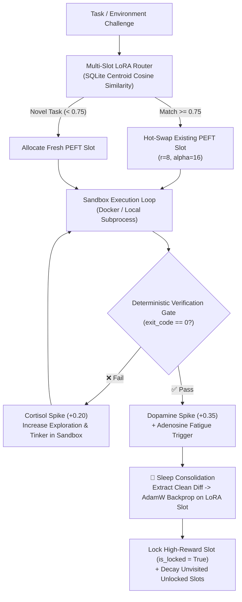

# 🧠 Neocortex (`Hackedghost64/neocortex`)

> **Modular Self-Improving Cognitive Loop with Biological Homeostasis (`Dopamine`/`Cortisol`/`Adenosine`), Dynamic Multi-Slot PEFT LoRA Hippocampus, Blind Sandbox Tinkering, and Sleep Consolidation.**

---

## Overview

Standard Large Language Models are **frozen at inference time** — they rely purely on ephemeral context windows and suffer from catastrophic forgetting if fine-tuned continuously on a single weight matrix.

**Neocortex** is a standalone, embeddable **self-improving cognitive loop** designed to integrate into coding engines, autonomous agents, or verification pipelines. It allows any local or remote Causal LM (`Qwen2`, `SmolLM2`, `Qwen2.5-Coder`) to **physically evolve its neural weights from verified trial-and-error** without catastrophic forgetting:

1. **Biological Homeostasis Regulator ([`regulator/state.py`](regulator/state.py)):**
   - Tracks three neuro-chemical state variables: **Dopamine** (reward & slot locking), **Cortisol** (error stress & exploration temperature boost), and **Adenosine** (cognitive fatigue & sleep-cycle trigger).
2. **Multi-Slot PEFT LoRA Hippocampus ([`engine/lora_manager.py`](engine/lora_manager.py)):**
   - Maintains a SQLite-indexed bank of discrete, hot-swappable PEFT LoRA adapters (`r=8, lora_alpha=16`).
   - Routes incoming problems by cosine similarity (`>= 0.75`) or dynamically allocates fresh LoRA slots.
   - Applies **synaptic salience decay** to unvisited slots while protecting **Dopamine-locked** core memories (`salience >= 0.50` floor).
3. **Blind Sandbox Tinkering ([`sandbox/docker_runner.py`](sandbox/docker_runner.py) & [`orchestrator.py`](orchestrator.py)):**
   - Drops the agent into an isolated sandbox with zero prior instructions.
   - When an attempt fails (`exit_code != 0`), **Cortisol** rises to force exploratory tinkering (inspecting files, reading tracebacks, synthesizing multi-file clues).
   - Once the deterministic verification gate passes (`exit_code == 0`), **Dopamine** spikes and **Adenosine** triggers a Sleep Cycle.
4. **Sleep Consolidation & Dreaming ([`sleep/distill.py`](sleep/distill.py) & [`sleep/curriculum.py`](sleep/curriculum.py)):**
   - Strips out all failed intermediate tinkering steps, extracts the minimal verified diff/action, and runs `AdamW` backpropagation on the active PEFT LoRA slot.
   - On wake-up (**Trial 2**), the agent solves the task in **1 step with 0 context window (`0` prompt examples)** purely from its updated LoRA weights.

---

## Architecture Diagram



---

## Verified Experimental Proofs

All proofs are implemented as deterministic, automated Pytest suites under [`tests/`](tests/):

| Proof / Test Suite | File | What It Proves |
| :--- | :--- | :--- |
| **1. Zero-Context Parametric Weight Proof** | [`tests/test_zero_context_weight_proof.py`](tests/test_zero_context_weight_proof.py) | Proves a real `transformers.Qwen2ForCausalLM` + `peft` (`r=8, alpha=16`) model fails before sleep, drops Cross-Entropy loss from **`4.3079 -> 0.0236`** during sleep, and generates the exact Python fix greedily with **zero examples in the prompt**. |
| **2. Blind Multi-Clue Sandbox Tinkering $\rightarrow$ 1-Step Mastery** | [`tests/test_blind_tinkering.py`](tests/test_blind_tinkering.py) | Drops the agent into a mystery broken repository with clues split across 3 files. **Trial 1:** Takes 3 tinkering steps (`Cortisol = 0.25`) to discover and fix. **Sleep:** Loss drops **`4.4842 -> 0.0255`**. **Trial 2 (Repo Reset):** Solves in **1 step (`0` tinkering, `Cortisol = 0.00`, `Dopamine = 1.00`, `LOCKED`)**. |
| **3. 5-Cycle Multi-Slot Hippocampus Stress Test** | [`tests/test_hippocampus_stress.py`](tests/test_hippocampus_stress.py) | Verifies multi-slot allocation across 5 simulated days, salience decay on unvisited adapters, and permanent protection of Dopamine-locked slots (`salience >= 0.50`). |
| **4. Core Subsystem Suites** | [`tests/test_engine.py`](tests/test_engine.py), [`tests/test_regulator.py`](tests/test_regulator.py), [`tests/test_sleep.py`](tests/test_sleep.py), [`tests/test_sandbox.py`](tests/test_sandbox.py), [`tests/test_integration.py`](tests/test_integration.py), [`tests/test_remote_colab.py`](tests/test_remote_colab.py) | 74 unit and integration tests across every protocol boundary. |

---

## Quick Start

```bash
# 1. Install dependencies
pip install -r requirements.txt

# 2. Run the Blind Tinkering -> Sleep -> 1-Step Mastery Proof
python3 -m pytest -v -s tests/test_blind_tinkering.py

# 3. Run the Zero-Context-Window Parametric LoRA Weight Proof
python3 -m pytest -v -s tests/test_zero_context_weight_proof.py

# 4. Run the 5-Day Multi-Slot Hippocampus Stress Test
python3 -m pytest -v -s tests/test_hippocampus_stress.py

# 5. Run the Full Neocortex Test Suite
python3 -m pytest -v tests/
```

---

## Repository Structure

- [`interfaces.py`](interfaces.py) — Strict dataclasses & protocols (`CommandResult`, `SlotRecord`, `TrainingPair`, `TrialOutcome`, `SandboxRunnerProtocol`, `HomeostasisProtocol`, `LoRAManagerProtocol`).
- [`regulator/state.py`](regulator/state.py) — Biological homeostasis state machine (`Homeostasis` with `dopamine`, `cortisol`, `adenosine`).
- [`engine/lora_manager.py`](engine/lora_manager.py) — Multi-slot HuggingFace `peft` LoRA manager + SQLite vector router (`LoRAManager`).
- [`engine/remote_colab.py`](engine/remote_colab.py) — Google Colab Pro A100 4-bit NF4 remote execution bridge (`ColabA100Bridge`).
- [`sleep/distill.py`](sleep/distill.py) & [`sleep/curriculum.py`](sleep/curriculum.py) — Trajectory distillation, `AdamW` LoRA consolidation, and foundational curriculum.
- [`sandbox/docker_runner.py`](sandbox/docker_runner.py) & [`sandbox/Dockerfile`](sandbox/Dockerfile) — Isolated container & local fallback execution runner.
- [`orchestrator.py`](orchestrator.py) — Full wake-tinker-sleep cognitive loop (`GenesisOrchestrator`).
- **Downstream Integration:** See [**Engram (`Hackedghost64/engram`)**](https://github.com/Hackedghost64/engram) for the integration of **Neocortex** into **Devrith (`arch-sidecar`)** for zero-token cross-repository bug repair.
