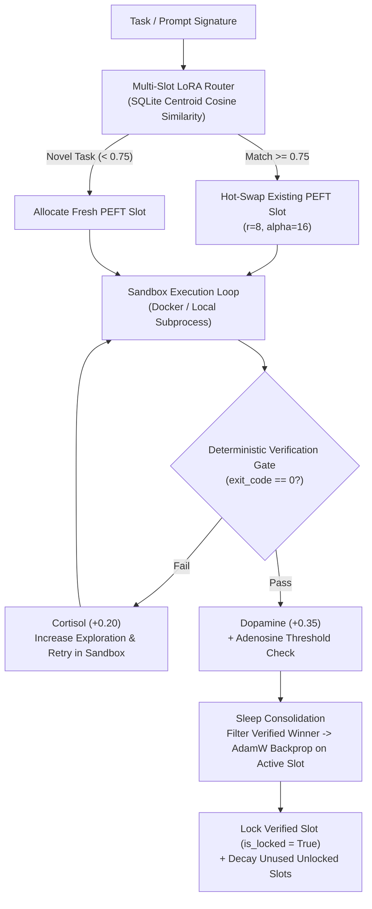

# 🧠 Neocortex (`Hackedghost64/neocortex`)

> **Experimental Test-Gated Continual Learning Harness — Multi-Slot PEFT LoRA Routing (`r=8, alpha=16`), Sandbox Verification Gate, and Homeostatic Loop Control.**

---

## Overview & Research Scope

**Neocortex** is an experimental research sandbox exploring how small language models (`Qwen2`, `SmolLM2-135M`, `Qwen2.5-Coder-0.5B`) behave when coupled with **isolated PEFT LoRA adapter slots** and a **deterministic verification gate** (`pytest` / subprocess exit codes).

Rather than updating a single monolithic weight matrix on unverified trajectories, Neocortex structures continual adaptation around four components:

1. **Homeostatic Loop Controller ([`regulator/state.py`](regulator/state.py)):**
   - A stateful heuristic controller modeled on three bounded state variables in `[0.0, 1.0]`:
     - **Dopamine:** Tracks verified task success and locks high-value LoRA slots against eviction.
     - **Cortisol:** Rises on consecutive sandbox failures (`exit_code != 0`) to increase sampling temperature / exploration and trigger halt conditions on runaway failure streaks.
     - **Adenosine:** Accumulates per action step to schedule offline LoRA gradient consolidation ("sleep").
2. **Multi-Slot PEFT LoRA Manager ([`engine/lora_manager.py`](engine/lora_manager.py)):**
   - Maintains a SQLite-indexed bank of hot-swappable PEFT LoRA adapters (`r=8, lora_alpha=16`).
   - Routes task signatures by cosine similarity (`>= 0.75`) or allocates a fresh adapter slot to reduce cross-task weight interference.
   - Applies salience decay to unused unlocked slots while preserving locked adapters (`salience >= 0.50`).
3. **Sandboxed Tinkering Loop ([`sandbox/docker_runner.py`](sandbox/docker_runner.py) & [`orchestrator.py`](orchestrator.py)):**
   - Executes candidate commands/patches inside a subprocess or Docker sandbox.
   - Only trajectories that pass the deterministic verification gate (`exit_code == 0`) are admitted into the training buffer.
4. **Sleep Consolidation ([`sleep/distill.py`](sleep/distill.py) & [`sleep/curriculum.py`](sleep/curriculum.py)):**
   - Filters out failed intermediate attempts, pairs the initial prompt with the final verified diff/action, and runs `AdamW` backpropagation on the active PEFT LoRA slot.

---

## Empirical Findings & Known Boundaries (Zero-Hype Ground Truth)

We evaluated what a rank-8 LoRA (`q_proj, k_proj, v_proj, o_proj`) on a frozen small model (`HuggingFaceTB/SmolLM2-135M-Instruct`) actually learns when trained on repository source code and queried with **zero context tokens**:

| Probe Category | What It Tests (0 Context Tokens at Inference) | Base Model (No LoRA) | Raw Source LoRA (`loss=0.166`) | Source + AST Q&A Cards LoRA (`loss=0.613`) |
| :--- | :--- | :---: | :---: | :---: |
| **Type A: Verbatim Prefix Completion** | Autocompleting an exact function/class signature prefix seen during sleep | `0 / 4` (`0%`) | **`2 / 4` (`50%`)** | **`2 / 4` (`50%`)** |
| **Type B: Paraphrased Repo Q&A** | Answering natural-language questions about constants/functions phrased differently from training | `0 / 4` (`0%`) | **`0 / 4` (`0%`)** | **`1 / 4` (`25%`)** |
| **Type C: Zero-Context API Usage** | Writing a valid function call to the repo's API from a comment specification | `0 / 2` (`0%`) | **`0 / 2` (`0%`)** | **`0 / 2` (`0%`)** |
| **Total** | **10 Zero-Context Probes** | **`0 / 10` (`0%`)** | **`2 / 10` (`20%`)** | **`3 / 10` (`30%`)** |

### Key Engineering Takeaways
1. **Weights Are For Behavioral Patterns, Not Factual Repo Storage:** Causal next-token training on `def fn(x=0.001):` learns $P(\text{code} \mid \text{prefix})$, **not** inverted natural-language lookup $P(\text{"0.001"} \mid \text{"What is the default rate?"})$ (the *reversal curse*). Packing 75+ Q&A cards into an `r=8` adapter causes subspace interference that degrades code completion.
2. **Use AST Retrieval for Facts, Verification Gates for Safety:** For repository facts, signatures, and fault localization, deterministic AST retrieval and `pytest` traceback analysis (see [**Devrith / `arch-sidecar`**](https://github.com/Hackedghost64/arch-sidecar)) deliver `100%` fidelity in `<50ms` versus minutes of lossy gradient descent.
3. **Where Multi-Slot LoRA Works:** Isolated LoRA slots are effective when the input prompt is structurally canonicalized (mapping recurring prompt/AST templates to verified transformations) and gated by an external test suite.

---

## Architecture Diagram



---

## Test Suites (`78/78` Passing)

All unit and integration checks are deterministic `pytest` suites under [`tests/`](tests/):

| Test Suite | File | What It Verifies |
| :--- | :--- | :--- |
| **1. Zero-Context Canonical Weight Update** | [`tests/test_zero_context_weight_proof.py`](tests/test_zero_context_weight_proof.py) | Verifies a `transformers.Qwen2ForCausalLM` + `peft` (`r=8, alpha=16`) adapter reduces Cross-Entropy loss (`4.3079 -> 0.0236`) on a verified `prompt -> patch` pair and reproduces the target patch greedily. |
| **2. Sandbox Tinkering $\rightarrow$ Sleep Consolidation** | [`tests/test_blind_tinkering.py`](tests/test_blind_tinkering.py) | Verifies multi-step sandbox exploration (`Cortisol = 0.25`), trajectory filtering on `exit_code == 0`, LoRA weight update (`4.4842 -> 0.0255`), and 1-step replay on the same task after reset. |
| **3. Multi-Slot Salience & Locking** | [`tests/test_hippocampus_stress.py`](tests/test_hippocampus_stress.py) | Verifies multi-slot allocation across 5 simulated cycles, salience decay on unvisited adapters, and retention of locked slots (`salience >= 0.50`). |
| **4. Subsystem Unit Tests** | [`tests/test_engine.py`](tests/test_engine.py), [`tests/test_regulator.py`](tests/test_regulator.py), [`tests/test_sleep.py`](tests/test_sleep.py), [`tests/test_sandbox.py`](tests/test_sandbox.py), [`tests/test_integration.py`](tests/test_integration.py), [`tests/test_remote_colab.py`](tests/test_remote_colab.py) | 74 unit and integration tests covering the state regulator, SQLite LoRA router, sandbox runner, and Colab bridge. |

---

## Quick Start

```bash
# Install dependencies
pip install -r requirements.txt

# Run the full 78-test suite
python3 -m pytest -v tests/
```

---

## Repository Structure

- [`interfaces.py`](interfaces.py) — Dataclasses & protocols (`CommandResult`, `SlotRecord`, `TrainingPair`, `TrialOutcome`, `SandboxRunnerProtocol`, `HomeostasisProtocol`, `LoRAManagerProtocol`).
- [`regulator/state.py`](regulator/state.py) — Homeostatic loop controller (`Homeostasis` with `dopamine`, `cortisol`, `adenosine`).
- [`engine/lora_manager.py`](engine/lora_manager.py) — Multi-slot HuggingFace `peft` LoRA manager + SQLite vector router (`LoRAManager`).
- [`engine/remote_colab.py`](engine/remote_colab.py) — Optional Google Colab GPU 4-bit NF4 remote execution bridge (`ColabA100Bridge`).
- [`sleep/distill.py`](sleep/distill.py) & [`sleep/curriculum.py`](sleep/curriculum.py) — Trajectory distillation and `AdamW` LoRA consolidation.
- [`sandbox/docker_runner.py`](sandbox/docker_runner.py) & [`sandbox/Dockerfile`](sandbox/Dockerfile) — Container & local subprocess execution runner.
- [`orchestrator.py`](orchestrator.py) — Wake-tinker-sleep loop coordinator (`GenesisOrchestrator`).
